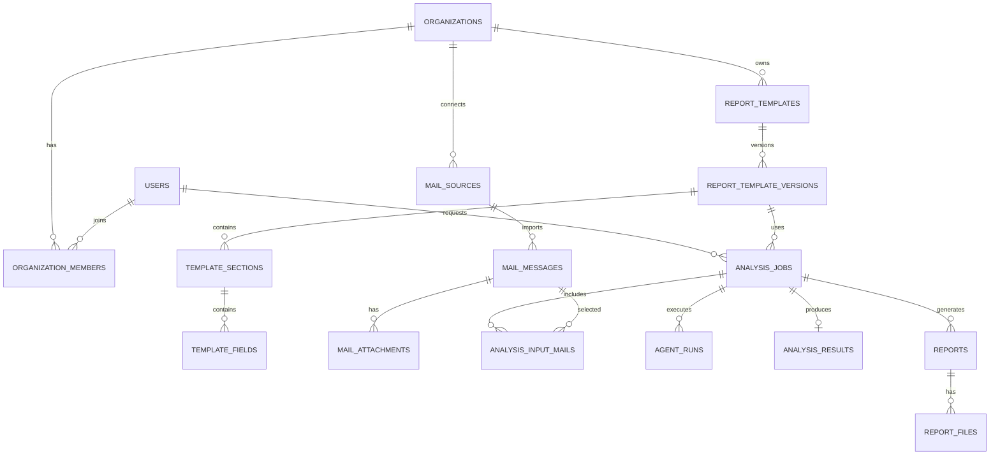

# Database Design

메일 분석 및 보고서 생성 플랫폼의 MVP 데이터베이스 설계 문서입니다.

초기에는 PostgreSQL 하나로 시작하되, 테이블 소유권은 서비스 경계에 맞춰
나눕니다. 나중에 서비스별 DB로 분리하더라도 외래 키 의존도를 줄일 수 있도록
다른 서비스의 엔티티는 `id` 값만 참조하는 방향을 기본으로 합니다.

## 설계 원칙

- PostgreSQL에는 사용자, 조직, 양식, 분석 작업, 보고서 메타데이터를 저장합니다.
- 원본 메일, 첨부파일, 생성된 PDF/DOCX 같은 큰 파일은 Object Storage에 저장하고,
  DB에는 위치와 메타데이터만 저장합니다.
- Redis에는 짧은 수명의 상태, 캐시, rate limit, 실시간 진행 상태를 둡니다.
- 이벤트 처리는 RabbitMQ를 우선 사용하고, DB에는 재처리와 추적이 필요한 작업 상태를
  명시적으로 남깁니다.
- 서비스 간에는 엔티티를 공유하지 않습니다. API DTO와 이벤트 메시지로만 통신합니다.
- 모든 주요 테이블은 `created_at`, `updated_at`을 가집니다.
- 삭제는 기본적으로 soft delete를 우선 검토하고, 원본 메일/보고서 파일은 보존 정책에 따라
  별도로 정리합니다.

## 핵심 관계



## 공통 컬럼 규칙

| 컬럼 | 타입 | 설명 |
| --- | --- | --- |
| `id` | `uuid` | 기본 키입니다. 애플리케이션에서 생성하는 UUID를 권장합니다. |
| `created_at` | `timestamptz` | 생성 시각입니다. |
| `updated_at` | `timestamptz` | 마지막 수정 시각입니다. |
| `deleted_at` | `timestamptz` | soft delete가 필요한 테이블에만 둡니다. |
| `metadata` | `jsonb` | 확장성이 필요한 보조 정보를 저장합니다. 남용하지 않습니다. |

## User Service

사용자와 조직은 대부분 서비스에서 필요하지만, 소유권은 User Service에 둡니다.
MVP에서 Auth Service와 User Service를 분리하기 전이라면 같은 DB 스키마 안에 두되
도메인 경계는 유지합니다.

### users

| 컬럼 | 타입 | 제약 | 설명 |
| --- | --- | --- | --- |
| `id` | `uuid` | PK | 사용자 ID |
| `email` | `varchar(320)` | unique, not null | 로그인 및 알림용 이메일 |
| `name` | `varchar(100)` | not null | 표시 이름 |
| `avatar_url` | `text` | nullable | 프로필 이미지 |
| `status` | `varchar(30)` | not null | `ACTIVE`, `INVITED`, `SUSPENDED`, `DELETED` |
| `locale` | `varchar(20)` | not null | 기본 언어. 예: `ko-KR` |
| `timezone` | `varchar(50)` | not null | 기본 시간대. 예: `Asia/Seoul` |
| `created_at` | `timestamptz` | not null | 생성 시각 |
| `updated_at` | `timestamptz` | not null | 수정 시각 |
| `deleted_at` | `timestamptz` | nullable | 삭제 시각 |

주요 인덱스:

- `uq_users_email`
- `idx_users_status`

### organizations

| 컬럼 | 타입 | 제약 | 설명 |
| --- | --- | --- | --- |
| `id` | `uuid` | PK | 조직 ID |
| `name` | `varchar(150)` | not null | 조직 이름 |
| `slug` | `varchar(80)` | unique, not null | URL 또는 식별용 짧은 이름 |
| `status` | `varchar(30)` | not null | `ACTIVE`, `SUSPENDED`, `DELETED` |
| `created_at` | `timestamptz` | not null | 생성 시각 |
| `updated_at` | `timestamptz` | not null | 수정 시각 |
| `deleted_at` | `timestamptz` | nullable | 삭제 시각 |

### organization_members

| 컬럼 | 타입 | 제약 | 설명 |
| --- | --- | --- | --- |
| `id` | `uuid` | PK | 멤버십 ID |
| `organization_id` | `uuid` | not null | 조직 ID |
| `user_id` | `uuid` | not null | 사용자 ID |
| `role` | `varchar(30)` | not null | `OWNER`, `ADMIN`, `MEMBER`, `VIEWER` |
| `status` | `varchar(30)` | not null | `ACTIVE`, `INVITED`, `REMOVED` |
| `joined_at` | `timestamptz` | nullable | 가입 완료 시각 |
| `created_at` | `timestamptz` | not null | 생성 시각 |
| `updated_at` | `timestamptz` | not null | 수정 시각 |

주요 인덱스:

- `uq_organization_members_org_user` on `organization_id`, `user_id`
- `idx_organization_members_user_id`

## Auth Service

OAuth2 또는 자체 로그인을 확장할 수 있게 인증 수단을 별도 테이블로 둡니다.

### auth_identities

| 컬럼 | 타입 | 제약 | 설명 |
| --- | --- | --- | --- |
| `id` | `uuid` | PK | 인증 식별자 ID |
| `user_id` | `uuid` | not null | 사용자 ID |
| `provider` | `varchar(40)` | not null | `LOCAL`, `GOOGLE`, `MICROSOFT` 등 |
| `provider_subject` | `varchar(255)` | not null | 외부 제공자 사용자 ID |
| `email` | `varchar(320)` | not null | 제공자 이메일 |
| `created_at` | `timestamptz` | not null | 생성 시각 |
| `updated_at` | `timestamptz` | not null | 수정 시각 |

주요 인덱스:

- `uq_auth_identities_provider_subject` on `provider`, `provider_subject`
- `idx_auth_identities_user_id`

### refresh_tokens

| 컬럼 | 타입 | 제약 | 설명 |
| --- | --- | --- | --- |
| `id` | `uuid` | PK | 토큰 ID |
| `user_id` | `uuid` | not null | 사용자 ID |
| `token_hash` | `text` | unique, not null | 원문이 아닌 해시 |
| `expires_at` | `timestamptz` | not null | 만료 시각 |
| `revoked_at` | `timestamptz` | nullable | 폐기 시각 |
| `created_at` | `timestamptz` | not null | 생성 시각 |

## Template Service

보고서 양식은 수정 이력과 재현성을 위해 버전 테이블을 중심으로 설계합니다.
분석 작업은 항상 특정 템플릿 버전을 참조합니다.

### report_templates

| 컬럼 | 타입 | 제약 | 설명 |
| --- | --- | --- | --- |
| `id` | `uuid` | PK | 양식 ID |
| `organization_id` | `uuid` | not null | 소유 조직 ID |
| `created_by_user_id` | `uuid` | not null | 최초 생성자 ID |
| `name` | `varchar(150)` | not null | 양식 이름 |
| `description` | `text` | nullable | 설명 |
| `status` | `varchar(30)` | not null | `DRAFT`, `ACTIVE`, `ARCHIVED` |
| `current_version_id` | `uuid` | nullable | 현재 활성 버전 ID |
| `created_at` | `timestamptz` | not null | 생성 시각 |
| `updated_at` | `timestamptz` | not null | 수정 시각 |
| `deleted_at` | `timestamptz` | nullable | 삭제 시각 |

주요 인덱스:

- `idx_report_templates_org_status`
- `idx_report_templates_created_by_user_id`

### report_template_versions

| 컬럼 | 타입 | 제약 | 설명 |
| --- | --- | --- | --- |
| `id` | `uuid` | PK | 양식 버전 ID |
| `template_id` | `uuid` | not null | 양식 ID |
| `version` | `integer` | not null | 1부터 증가하는 버전 |
| `title_format` | `varchar(200)` | nullable | 생성 보고서 제목 형식 |
| `schema_snapshot` | `jsonb` | not null | 섹션/필드 전체 스냅샷 |
| `validation_schema` | `jsonb` | nullable | 입력값 검증 규칙 |
| `status` | `varchar(30)` | not null | `DRAFT`, `PUBLISHED`, `ARCHIVED` |
| `published_at` | `timestamptz` | nullable | 발행 시각 |
| `created_by_user_id` | `uuid` | not null | 버전 생성자 ID |
| `created_at` | `timestamptz` | not null | 생성 시각 |

주요 인덱스:

- `uq_report_template_versions_template_version` on `template_id`, `version`
- `idx_report_template_versions_template_status`

### template_sections

| 컬럼 | 타입 | 제약 | 설명 |
| --- | --- | --- | --- |
| `id` | `uuid` | PK | 섹션 ID |
| `template_version_id` | `uuid` | not null | 양식 버전 ID |
| `key` | `varchar(80)` | not null | 섹션 키 |
| `title` | `varchar(150)` | not null | 섹션 제목 |
| `description` | `text` | nullable | 에이전트와 사용자에게 보여줄 설명 |
| `sort_order` | `integer` | not null | 표시 순서 |
| `created_at` | `timestamptz` | not null | 생성 시각 |
| `updated_at` | `timestamptz` | not null | 수정 시각 |

### template_fields

| 컬럼 | 타입 | 제약 | 설명 |
| --- | --- | --- | --- |
| `id` | `uuid` | PK | 필드 ID |
| `template_section_id` | `uuid` | not null | 섹션 ID |
| `key` | `varchar(80)` | not null | 필드 키 |
| `label` | `varchar(150)` | not null | 표시 이름 |
| `field_type` | `varchar(40)` | not null | `TEXT`, `NUMBER`, `DATE`, `BOOLEAN`, `SELECT`, `TABLE`, `RICH_TEXT` |
| `required` | `boolean` | not null | 필수 여부 |
| `options` | `jsonb` | nullable | 선택지, 테이블 컬럼 등 타입별 설정 |
| `extraction_hint` | `text` | nullable | AI 추출 힌트 |
| `sort_order` | `integer` | not null | 표시 순서 |
| `created_at` | `timestamptz` | not null | 생성 시각 |
| `updated_at` | `timestamptz` | not null | 수정 시각 |

주요 인덱스:

- `uq_template_sections_version_key` on `template_version_id`, `key`
- `uq_template_fields_section_key` on `template_section_id`, `key`

## Mail Ingestion Service

MVP에서는 사용자가 선택한 파일 또는 메일 원문을 업로드하는 방식부터 시작하고,
이후 Gmail, Microsoft 365, IMAP 연동을 추가할 수 있습니다.

### mail_sources

| 컬럼 | 타입 | 제약 | 설명 |
| --- | --- | --- | --- |
| `id` | `uuid` | PK | 메일 소스 ID |
| `organization_id` | `uuid` | not null | 조직 ID |
| `created_by_user_id` | `uuid` | not null | 등록자 ID |
| `provider` | `varchar(40)` | not null | `UPLOAD`, `GMAIL`, `MICROSOFT_365`, `IMAP` |
| `display_name` | `varchar(150)` | not null | 사용자가 보는 이름 |
| `status` | `varchar(30)` | not null | `ACTIVE`, `DISCONNECTED`, `ERROR`, `DELETED` |
| `config` | `jsonb` | nullable | 암호화가 필요 없는 설정 |
| `last_synced_at` | `timestamptz` | nullable | 마지막 동기화 시각 |
| `created_at` | `timestamptz` | not null | 생성 시각 |
| `updated_at` | `timestamptz` | not null | 수정 시각 |
| `deleted_at` | `timestamptz` | nullable | 삭제 시각 |

민감한 토큰은 이 테이블에 직접 저장하지 않고 Secret Manager 또는 별도 암호화 저장소를 사용합니다.

### mail_messages

| 컬럼 | 타입 | 제약 | 설명 |
| --- | --- | --- | --- |
| `id` | `uuid` | PK | 메일 ID |
| `organization_id` | `uuid` | not null | 조직 ID |
| `mail_source_id` | `uuid` | nullable | 메일 소스 ID |
| `external_message_id` | `varchar(512)` | nullable | 제공자 메시지 ID |
| `thread_id` | `varchar(512)` | nullable | 제공자 스레드 ID |
| `subject` | `text` | nullable | 제목 |
| `from_address` | `varchar(320)` | nullable | 발신자 |
| `to_addresses` | `jsonb` | not null | 수신자 목록 |
| `cc_addresses` | `jsonb` | nullable | 참조 목록 |
| `sent_at` | `timestamptz` | nullable | 발송 시각 |
| `received_at` | `timestamptz` | nullable | 수신 시각 |
| `normalized_text` | `text` | nullable | 정규화된 본문 텍스트 |
| `raw_object_key` | `text` | nullable | 원본 메일 Object Storage key |
| `body_object_key` | `text` | nullable | 긴 본문 Object Storage key |
| `content_hash` | `varchar(128)` | nullable | 중복 감지용 해시 |
| `status` | `varchar(30)` | not null | `RECEIVED`, `NORMALIZED`, `FAILED`, `DELETED` |
| `created_at` | `timestamptz` | not null | 생성 시각 |
| `updated_at` | `timestamptz` | not null | 수정 시각 |

주요 인덱스:

- `idx_mail_messages_org_received_at`
- `idx_mail_messages_source_external_id`
- `idx_mail_messages_content_hash`
- `idx_mail_messages_subject_fts` using GIN full-text search

### mail_attachments

| 컬럼 | 타입 | 제약 | 설명 |
| --- | --- | --- | --- |
| `id` | `uuid` | PK | 첨부파일 ID |
| `mail_message_id` | `uuid` | not null | 메일 ID |
| `file_name` | `varchar(255)` | not null | 원본 파일명 |
| `content_type` | `varchar(150)` | nullable | MIME 타입 |
| `size_bytes` | `bigint` | nullable | 파일 크기 |
| `object_key` | `text` | not null | Object Storage key |
| `content_hash` | `varchar(128)` | nullable | 중복 감지용 해시 |
| `extracted_text` | `text` | nullable | 추출 텍스트 |
| `created_at` | `timestamptz` | not null | 생성 시각 |

## Analysis Service

분석 작업의 비즈니스 상태는 Analysis Service가 소유합니다.
Agent Orchestrator는 실행을 담당하지만 최종 작업 상태의 기준은 `analysis_jobs`입니다.

### analysis_jobs

| 컬럼 | 타입 | 제약 | 설명 |
| --- | --- | --- | --- |
| `id` | `uuid` | PK | 분석 작업 ID |
| `organization_id` | `uuid` | not null | 조직 ID |
| `requested_by_user_id` | `uuid` | not null | 요청자 ID |
| `template_version_id` | `uuid` | not null | 사용할 양식 버전 ID |
| `title` | `varchar(200)` | nullable | 사용자가 지정한 작업명 |
| `status` | `varchar(30)` | not null | `REQUESTED`, `QUEUED`, `RUNNING`, `COMPLETED`, `FAILED`, `CANCELED` |
| `priority` | `integer` | not null | 우선순위 |
| `input_summary` | `jsonb` | nullable | 입력 개수, 기간 등 요약 |
| `failure_code` | `varchar(80)` | nullable | 실패 코드 |
| `failure_message` | `text` | nullable | 실패 메시지 |
| `requested_at` | `timestamptz` | not null | 요청 시각 |
| `started_at` | `timestamptz` | nullable | 시작 시각 |
| `completed_at` | `timestamptz` | nullable | 완료 시각 |
| `created_at` | `timestamptz` | not null | 생성 시각 |
| `updated_at` | `timestamptz` | not null | 수정 시각 |

주요 인덱스:

- `idx_analysis_jobs_org_status_created`
- `idx_analysis_jobs_requested_by_user_id`
- `idx_analysis_jobs_template_version_id`

### analysis_input_mails

| 컬럼 | 타입 | 제약 | 설명 |
| --- | --- | --- | --- |
| `id` | `uuid` | PK | 입력 메일 ID |
| `analysis_job_id` | `uuid` | not null | 분석 작업 ID |
| `mail_message_id` | `uuid` | not null | 메일 ID |
| `created_at` | `timestamptz` | not null | 생성 시각 |

주요 인덱스:

- `uq_analysis_input_mails_job_mail` on `analysis_job_id`, `mail_message_id`

### analysis_results

| 컬럼 | 타입 | 제약 | 설명 |
| --- | --- | --- | --- |
| `id` | `uuid` | PK | 분석 결과 ID |
| `analysis_job_id` | `uuid` | unique, not null | 분석 작업 ID |
| `result_data` | `jsonb` | not null | 양식 필드 key에 맞춘 구조화 결과 |
| `confidence_summary` | `jsonb` | nullable | 필드별 신뢰도 요약 |
| `evidence` | `jsonb` | nullable | 근거 메일, 문장 위치 등 |
| `created_at` | `timestamptz` | not null | 생성 시각 |
| `updated_at` | `timestamptz` | not null | 수정 시각 |

## Agent Orchestrator

장기 보관 비즈니스 데이터는 Analysis Service에 두고, Orchestrator에는 실행 추적과
디버깅에 필요한 최소 메타데이터만 둡니다.

### agent_runs

| 컬럼 | 타입 | 제약 | 설명 |
| --- | --- | --- | --- |
| `id` | `uuid` | PK | 에이전트 실행 ID |
| `analysis_job_id` | `uuid` | not null | 분석 작업 ID |
| `workflow_name` | `varchar(100)` | not null | LangGraph 워크플로우 이름 |
| `workflow_version` | `varchar(50)` | not null | 워크플로우 버전 |
| `status` | `varchar(30)` | not null | `CREATED`, `RUNNING`, `SUCCEEDED`, `FAILED`, `CANCELED` |
| `input_snapshot` | `jsonb` | nullable | 실행 입력 요약 |
| `output_snapshot` | `jsonb` | nullable | 실행 출력 요약 |
| `token_usage` | `jsonb` | nullable | 모델별 토큰 사용량 |
| `error_message` | `text` | nullable | 오류 메시지 |
| `started_at` | `timestamptz` | nullable | 시작 시각 |
| `finished_at` | `timestamptz` | nullable | 종료 시각 |
| `created_at` | `timestamptz` | not null | 생성 시각 |
| `updated_at` | `timestamptz` | not null | 수정 시각 |

### agent_steps

| 컬럼 | 타입 | 제약 | 설명 |
| --- | --- | --- | --- |
| `id` | `uuid` | PK | 실행 단계 ID |
| `agent_run_id` | `uuid` | not null | 에이전트 실행 ID |
| `step_name` | `varchar(100)` | not null | 단계 이름 |
| `step_type` | `varchar(50)` | not null | `LLM`, `TOOL`, `TRANSFORM`, `VALIDATION` |
| `status` | `varchar(30)` | not null | `PENDING`, `RUNNING`, `SUCCEEDED`, `FAILED`, `SKIPPED` |
| `input_data` | `jsonb` | nullable | 입력 요약 |
| `output_data` | `jsonb` | nullable | 출력 요약 |
| `error_message` | `text` | nullable | 오류 메시지 |
| `started_at` | `timestamptz` | nullable | 시작 시각 |
| `finished_at` | `timestamptz` | nullable | 종료 시각 |
| `created_at` | `timestamptz` | not null | 생성 시각 |

## Report Service

보고서는 분석 결과와 양식 버전을 기준으로 생성됩니다.
보고서 파일은 Object Storage에 저장하고, DB에는 다운로드와 감사에 필요한 메타데이터를 둡니다.

### reports

| 컬럼 | 타입 | 제약 | 설명 |
| --- | --- | --- | --- |
| `id` | `uuid` | PK | 보고서 ID |
| `organization_id` | `uuid` | not null | 조직 ID |
| `analysis_job_id` | `uuid` | not null | 분석 작업 ID |
| `template_version_id` | `uuid` | not null | 사용한 양식 버전 ID |
| `title` | `varchar(200)` | not null | 보고서 제목 |
| `status` | `varchar(30)` | not null | `REQUESTED`, `GENERATING`, `GENERATED`, `FAILED`, `DELETED` |
| `rendered_data` | `jsonb` | nullable | 최종 렌더링에 사용한 데이터 스냅샷 |
| `failure_message` | `text` | nullable | 실패 메시지 |
| `created_by_user_id` | `uuid` | not null | 생성 요청자 ID |
| `generated_at` | `timestamptz` | nullable | 생성 완료 시각 |
| `created_at` | `timestamptz` | not null | 생성 시각 |
| `updated_at` | `timestamptz` | not null | 수정 시각 |
| `deleted_at` | `timestamptz` | nullable | 삭제 시각 |

주요 인덱스:

- `idx_reports_org_created`
- `idx_reports_analysis_job_id`
- `idx_reports_status`

### report_files

| 컬럼 | 타입 | 제약 | 설명 |
| --- | --- | --- | --- |
| `id` | `uuid` | PK | 보고서 파일 ID |
| `report_id` | `uuid` | not null | 보고서 ID |
| `file_type` | `varchar(20)` | not null | `HTML`, `PDF`, `DOCX`, `JSON` |
| `file_name` | `varchar(255)` | not null | 다운로드 파일명 |
| `content_type` | `varchar(150)` | not null | MIME 타입 |
| `size_bytes` | `bigint` | nullable | 파일 크기 |
| `object_key` | `text` | not null | Object Storage key |
| `created_at` | `timestamptz` | not null | 생성 시각 |

주요 인덱스:

- `uq_report_files_report_type` on `report_id`, `file_type`

## Notification Service

MVP에서는 실시간 상태 조회만으로 시작해도 되지만, 분석 완료/실패 알림 이력을 남길 수 있게
확장 테이블을 준비합니다.

### notifications

| 컬럼 | 타입 | 제약 | 설명 |
| --- | --- | --- | --- |
| `id` | `uuid` | PK | 알림 ID |
| `organization_id` | `uuid` | not null | 조직 ID |
| `user_id` | `uuid` | not null | 수신자 ID |
| `type` | `varchar(50)` | not null | `ANALYSIS_COMPLETED`, `ANALYSIS_FAILED`, `REPORT_GENERATED` |
| `title` | `varchar(200)` | not null | 알림 제목 |
| `body` | `text` | nullable | 알림 본문 |
| `resource_type` | `varchar(50)` | nullable | 연결 리소스 타입 |
| `resource_id` | `uuid` | nullable | 연결 리소스 ID |
| `read_at` | `timestamptz` | nullable | 읽은 시각 |
| `created_at` | `timestamptz` | not null | 생성 시각 |

주요 인덱스:

- `idx_notifications_user_created`
- `idx_notifications_user_read`

## Audit

권한, 메일 데이터, 보고서 생성은 감사 추적이 중요하므로 공통 audit 테이블을 둡니다.
초기에는 단일 테이블로 충분하고, 규모가 커지면 월별 파티셔닝을 검토합니다.

### audit_logs

| 컬럼 | 타입 | 제약 | 설명 |
| --- | --- | --- | --- |
| `id` | `uuid` | PK | 감사 로그 ID |
| `organization_id` | `uuid` | nullable | 조직 ID |
| `actor_user_id` | `uuid` | nullable | 행위자 ID |
| `action` | `varchar(100)` | not null | 예: `REPORT_TEMPLATE_CREATED` |
| `resource_type` | `varchar(80)` | not null | 대상 리소스 타입 |
| `resource_id` | `uuid` | nullable | 대상 리소스 ID |
| `ip_address` | `inet` | nullable | 요청 IP |
| `user_agent` | `text` | nullable | User-Agent |
| `details` | `jsonb` | nullable | 추가 정보 |
| `created_at` | `timestamptz` | not null | 생성 시각 |

주요 인덱스:

- `idx_audit_logs_org_created`
- `idx_audit_logs_actor_created`
- `idx_audit_logs_resource`

## 이벤트와 상태 전이

| 이벤트 | 발행 서비스 | 소비 서비스 | 관련 테이블 |
| --- | --- | --- | --- |
| `mail.received` | Mail Ingestion | Mail Ingestion, Analysis | `mail_messages` |
| `mail.normalized` | Mail Ingestion | Analysis | `mail_messages` |
| `analysis.requested` | Analysis | Agent Orchestrator | `analysis_jobs` |
| `analysis.started` | Agent Orchestrator | Analysis, Notification | `analysis_jobs`, `agent_runs` |
| `analysis.completed` | Agent Orchestrator | Analysis, Report, Notification | `analysis_results`, `analysis_jobs` |
| `analysis.failed` | Agent Orchestrator | Analysis, Notification | `analysis_jobs`, `agent_runs` |
| `report.requested` | Analysis or Web API | Report | `reports` |
| `report.generated` | Report | Notification | `reports`, `report_files` |
| `notification.requested` | Analysis or Report | Notification | `notifications` |

분석 작업 상태 전이:

```text
REQUESTED -> QUEUED -> RUNNING -> COMPLETED
REQUESTED -> QUEUED -> RUNNING -> FAILED
REQUESTED -> QUEUED -> CANCELED
```

보고서 상태 전이:

```text
REQUESTED -> GENERATING -> GENERATED
REQUESTED -> GENERATING -> FAILED
GENERATED -> DELETED
```

## Object Storage Key 규칙

초기 key 규칙은 사람이 읽을 수 있으면서 조직별 분리가 쉬운 형태로 둡니다.

```text
organizations/{organizationId}/mail/{mailMessageId}/raw.eml
organizations/{organizationId}/mail/{mailMessageId}/attachments/{attachmentId}/{fileName}
organizations/{organizationId}/reports/{reportId}/{fileType}/{fileName}
```

파일명에는 원본 이름을 보존하되, 실제 key 생성 시 경로 구분자와 제어 문자는 제거합니다.

## MVP에서 먼저 만들 테이블

첫 백엔드 구현 단위에서는 다음 순서가 적당합니다.

1. `users`
2. `organizations`
3. `organization_members`
4. `report_templates`
5. `report_template_versions`
6. `template_sections`
7. `template_fields`
8. `analysis_jobs`
9. `analysis_results`
10. `reports`
11. `report_files`

메일 수집 연동은 아직 뒤 단계이므로 `mail_sources`, `mail_messages`, `mail_attachments`는
초기에는 샘플 입력 또는 업로드 입력 설계가 확정될 때 추가합니다.

## 보류할 결정

- 서비스별 독립 DB를 바로 둘지, 하나의 PostgreSQL 인스턴스에서 schema만 나눌지
- 템플릿 스키마를 완전히 정규화할지, `schema_snapshot` 중심으로 단순화할지
- 메일 본문 검색을 PostgreSQL full-text search로 시작할지, OpenSearch를 별도로 둘지
- 대용량 감사 로그와 실행 로그를 언제 파티셔닝할지
- 외부 메일 연동 토큰 저장을 Secret Manager로 할지, 앱 레벨 암호화 테이블로 시작할지

## 다음 구현 후보

1. Flyway 또는 Liquibase 기준 선택
2. MVP 테이블의 첫 마이그레이션 작성
3. Template Service의 Spring Boot 프로젝트 생성
4. Report Template 생성/조회 API 설계
5. 프론트엔드 양식 편집 화면과 API 연결
